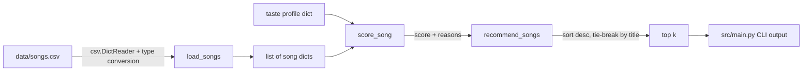

# 🎵 Music Recommender Simulation

## Project Summary

This project is a small, CLI-first, **content-based** music recommender. It loads a 20-song catalog from `data/songs.csv`, compares each song to a user's taste profile (favorite genre, favorite mood, target energy, and an optional acoustic preference), gives every song a weighted score, and prints the top 5 with a line-by-line explanation of where each point came from. It also includes a weight-shift experiment and a model card that discusses its biases.

---

## Content-Based vs. Collaborative Filtering

- **Collaborative filtering** recommends based on *other people's behavior*: "users who liked what you liked also liked X." It needs lots of user interaction data (plays, likes, skips) and knows nothing about the songs themselves.
- **Content-based filtering** recommends based on *the item's own features*: "this song is pop, happy, and high energy, and so is your profile." It works with zero other users, which is why it fits this project, but it can only recommend things that look like what you already said you like.

This project is purely content-based. There is no user history or other users in the data.

---

## How The System Works

### Data features

The real CSV header is:

```
id,title,artist,genre,mood,energy,tempo_bpm,valence,danceability,acousticness
```

| Column | Type | Used in score? |
|---|---|---|
| `id` | int | No (tie-breaker only) |
| `title`, `artist` | text | No (display only; title is a tie-breaker) |
| `genre` | text | **Yes** — exact match |
| `mood` | text | **Yes** — exact match |
| `energy` | float 0–1 | **Yes** — closeness to target |
| `acousticness` | float 0–1 | **Yes** — only if the profile sets `likes_acoustic` |
| `tempo_bpm`, `valence`, `danceability` | float | Loaded and validated, but not scored (kept simple on purpose) |

### Taste profiles

A taste profile is a plain dictionary. All keys are optional:

```python
{"genre": "lofi", "mood": "chill", "target_energy": 0.35, "likes_acoustic": True}
```

The starter key `"energy"` is also accepted as an alias for `"target_energy"`. The `UserProfile` dataclass used by the `Recommender` class is converted into this same dictionary, so both APIs share one scoring function.

### Scoring recipe

For each song:

| Rule | Points |
|---|---|
| Genre matches (case-insensitive) | **+2.0** |
| Mood matches (case-insensitive) | **+1.0** |
| Energy closeness | **+1.0 × max(0, 1 − \|song_energy − target_energy\|)** |
| Acoustic fit (only if `likes_acoustic` is set) | **+0.5 × acousticness** if True, **+0.5 × (1 − acousticness)** if False |

Maximum possible score is 4.5 (or 4.0 without an acoustic preference). Energy and acousticness are already on a 0–1 scale in the CSV, so no extra normalization is needed; `load_songs` rejects rows where they fall outside 0–1.

Every rule adds a reason string, including misses (e.g. `genre 'rock' is not 'pop' (+0.00)`), so the output shows *why* a song ranked where it did.

### Ranking

`recommend_songs` scores every song, sorts by score (highest first), breaks ties by title then id so results are deterministic, and returns the top `k` as `(song, score, explanation)` tuples. An empty catalog or `k <= 0` returns `[]`.

### Data flow



### Expected biases (before testing)

- Genre is worth twice as much as mood, so a genre match alone (+2.0) can beat a song that matches mood and energy perfectly (+2.0 max). I expected genre to dominate.
- Matching is exact text, so `indie pop` gets no genre credit from a `pop` profile.
- Most genres only have one song, so users of rare genres get thin results.

---

## Getting Started

### Setup

1. Create a virtual environment (optional but recommended):

   ```bash
   python3 -m venv .venv
   source .venv/bin/activate      # Mac or Linux
   .venv\Scripts\activate         # Windows
   ```

2. Install dependencies (the recommender itself only uses the standard library; `pytest` is needed for tests):

   ```bash
   pip install -r requirements.txt
   ```

3. Run the app from the repository root:

   ```bash
   python -m src.main                # top 5 for every evaluation profile
   python -m src.main --experiment   # baseline vs. shifted weights
   python -m src.main -k 3           # change how many results are shown
   ```

### Running Tests

```bash
python -m pytest
```

`pytest.ini` adds the repo root to the import path, so plain `pytest` works too. The suite (`tests/test_recommender.py` from the starter plus `tests/test_scoring.py`) covers CSV loading, numeric conversion, skipping invalid rows, missing/empty files, genre and mood scoring, energy closeness, the acoustic bonus, explanation strings, descending order, top-k limits, empty catalogs, tie-breaking, and making sure experiment weights don't modify the defaults. Last run: **20 passed**.

---

## Sample Recommendation Output

Four profiles are defined in `src/main.py`: three contrasting ones (High-Energy Pop, Chill Lofi, Intense Rock) and one deliberately contradictory one (ambient genre + angry mood + 0.95 energy). This is the real output of `python -m src.main`:

```
Loaded songs: 20

========================================================================
Profile: High-Energy Pop
Prefs:   {'genre': 'pop', 'mood': 'happy', 'target_energy': 0.85}
------------------------------------------------------------------------
1. Sunrise City by Neon Echo  [pop, happy]  Score: 3.97
     - genre matches 'pop' (+2.00)
     - mood matches 'happy' (+1.00)
     - energy 0.82 vs target 0.85 (+0.97)
2. Gym Hero by Max Pulse  [pop, intense]  Score: 2.92
     - genre matches 'pop' (+2.00)
     - mood 'intense' is not 'happy' (+0.00)
     - energy 0.93 vs target 0.85 (+0.92)
3. Neon Heartbreak by Glass Arcade  [pop, sad]  Score: 2.79
     - genre matches 'pop' (+2.00)
     - mood 'sad' is not 'happy' (+0.00)
     - energy 0.64 vs target 0.85 (+0.79)
4. Rooftop Lights by Indigo Parade  [indie pop, happy]  Score: 1.91
     - genre 'indie pop' is not 'pop' (+0.00)
     - mood matches 'happy' (+1.00)
     - energy 0.76 vs target 0.85 (+0.91)
5. Basement Riot by Cutthroat Choir  [rock, angry]  Score: 0.97
     - genre 'rock' is not 'pop' (+0.00)
     - mood 'angry' is not 'happy' (+0.00)
     - energy 0.88 vs target 0.85 (+0.97)

========================================================================
Profile: Chill Lofi
Prefs:   {'genre': 'lofi', 'mood': 'chill', 'target_energy': 0.35, 'likes_acoustic': True}
------------------------------------------------------------------------
1. Library Rain by Paper Lanterns  [lofi, chill]  Score: 4.43
     - genre matches 'lofi' (+2.00)
     - mood matches 'chill' (+1.00)
     - energy 0.35 vs target 0.35 (+1.00)
     - acoustic fit 0.86 (+0.43)
2. Midnight Coding by LoRoom  [lofi, chill]  Score: 4.29
     - genre matches 'lofi' (+2.00)
     - mood matches 'chill' (+1.00)
     - energy 0.42 vs target 0.35 (+0.93)
     - acoustic fit 0.71 (+0.35)
3. Focus Flow by LoRoom  [lofi, focused]  Score: 3.34
     - genre matches 'lofi' (+2.00)
     - mood 'focused' is not 'chill' (+0.00)
     - energy 0.40 vs target 0.35 (+0.95)
     - acoustic fit 0.78 (+0.39)
4. Spacewalk Thoughts by Orbit Bloom  [ambient, chill]  Score: 2.39
     - genre 'ambient' is not 'lofi' (+0.00)
     - mood matches 'chill' (+1.00)
     - energy 0.28 vs target 0.35 (+0.93)
     - acoustic fit 0.92 (+0.46)
5. Coffee Shop Stories by Slow Stereo  [jazz, relaxed]  Score: 1.43
     - genre 'jazz' is not 'lofi' (+0.00)
     - mood 'relaxed' is not 'chill' (+0.00)
     - energy 0.37 vs target 0.35 (+0.98)
     - acoustic fit 0.89 (+0.45)

========================================================================
Profile: Intense Rock
Prefs:   {'genre': 'rock', 'mood': 'intense', 'target_energy': 0.9}
------------------------------------------------------------------------
1. Storm Runner by Voltline  [rock, intense]  Score: 3.99
     - genre matches 'rock' (+2.00)
     - mood matches 'intense' (+1.00)
     - energy 0.91 vs target 0.90 (+0.99)
2. Basement Riot by Cutthroat Choir  [rock, angry]  Score: 2.98
     - genre matches 'rock' (+2.00)
     - mood 'angry' is not 'intense' (+0.00)
     - energy 0.88 vs target 0.90 (+0.98)
3. Gym Hero by Max Pulse  [pop, intense]  Score: 1.97
     - genre 'pop' is not 'rock' (+0.00)
     - mood matches 'intense' (+1.00)
     - energy 0.93 vs target 0.90 (+0.97)
4. Pulse Reactor by Kilowatt Kid  [edm, euphoric]  Score: 0.95
     - genre 'edm' is not 'rock' (+0.00)
     - mood 'euphoric' is not 'intense' (+0.00)
     - energy 0.95 vs target 0.90 (+0.95)
5. Iron Lung Parade by Grave Engine  [metal, angry]  Score: 0.93
     - genre 'metal' is not 'rock' (+0.00)
     - mood 'angry' is not 'intense' (+0.00)
     - energy 0.97 vs target 0.90 (+0.93)

========================================================================
Profile: Contradictory (Ambient + Angry + 0.95)
Prefs:   {'genre': 'ambient', 'mood': 'angry', 'target_energy': 0.95}
------------------------------------------------------------------------
1. Spacewalk Thoughts by Orbit Bloom  [ambient, chill]  Score: 2.33
     - genre matches 'ambient' (+2.00)
     - mood 'chill' is not 'angry' (+0.00)
     - energy 0.28 vs target 0.95 (+0.33)
2. Iron Lung Parade by Grave Engine  [metal, angry]  Score: 1.98
     - genre 'metal' is not 'ambient' (+0.00)
     - mood matches 'angry' (+1.00)
     - energy 0.97 vs target 0.95 (+0.98)
3. Basement Riot by Cutthroat Choir  [rock, angry]  Score: 1.93
     - genre 'rock' is not 'ambient' (+0.00)
     - mood matches 'angry' (+1.00)
     - energy 0.88 vs target 0.95 (+0.93)
4. Pulse Reactor by Kilowatt Kid  [edm, euphoric]  Score: 1.00
     - genre 'edm' is not 'ambient' (+0.00)
     - mood 'euphoric' is not 'angry' (+0.00)
     - energy 0.95 vs target 0.95 (+1.00)
5. Gym Hero by Max Pulse  [pop, intense]  Score: 0.98
     - genre 'pop' is not 'ambient' (+0.00)
     - mood 'intense' is not 'angry' (+0.00)
     - energy 0.93 vs target 0.95 (+0.98)
```

---

## Experiments You Tried

### Weight shift: halve genre, double energy

`python -m src.main --experiment` re-ranks every profile with `genre=1.0, energy=2.0` (mood and acoustic unchanged). The experiment weights are passed in as an argument, so `DEFAULT_WEIGHTS` and the normal CLI output are never changed (a test checks this). Real output:

```
Loaded songs: 20

Baseline weights:   genre=2.0, mood=1.0, energy=1.0, acoustic=0.5
Experiment weights: genre=1.0, mood=1.0, energy=2.0, acoustic=0.5

========================================================================
Profile: High-Energy Pop
#  Baseline                          Experiment
1  Sunrise City (3.97)               Sunrise City (3.94)
2  Gym Hero (2.92)                   Gym Hero (2.84)
3  Neon Heartbreak (2.79)            Rooftop Lights (2.82)
4  Rooftop Lights (1.91)             Neon Heartbreak (2.58)
5  Basement Riot (0.97)              Basement Riot (1.94)

========================================================================
Profile: Chill Lofi
#  Baseline                          Experiment
1  Library Rain (4.43)               Library Rain (4.43)
2  Midnight Coding (4.29)            Midnight Coding (4.21)
3  Focus Flow (3.34)                 Spacewalk Thoughts (3.32)
4  Spacewalk Thoughts (2.39)         Focus Flow (3.29)
5  Coffee Shop Stories (1.43)        Coffee Shop Stories (2.40)

========================================================================
Profile: Intense Rock
#  Baseline                          Experiment
1  Storm Runner (3.99)               Storm Runner (3.98)
2  Basement Riot (2.98)              Basement Riot (2.96)
3  Gym Hero (1.97)                   Gym Hero (2.94)
4  Pulse Reactor (0.95)              Pulse Reactor (1.90)
5  Iron Lung Parade (0.93)           Iron Lung Parade (1.86)

========================================================================
Profile: Contradictory (Ambient + Angry + 0.95)
#  Baseline                          Experiment
1  Spacewalk Thoughts (2.33)         Iron Lung Parade (2.96)
2  Iron Lung Parade (1.98)           Basement Riot (2.86)
3  Basement Riot (1.93)              Pulse Reactor (2.00)
4  Pulse Reactor (1.00)              Gym Hero (1.96)
5  Gym Hero (0.98)                   Storm Runner (1.92)
```

**What changed:**

- **High-Energy Pop:** *Rooftop Lights* (indie pop, happy, 0.76) moved from #4 to #3 and passed *Neon Heartbreak* (pop, **sad**, 0.64). That feels like a better result: a happy song with the right energy now beats a sad song that only shares the genre label.
- **Chill Lofi:** *Spacewalk Thoughts* (ambient, chill) moved from #4 to #3, passing *Focus Flow* (lofi, focused). Mood + energy started to matter more than the genre label.
- **Intense Rock:** Order stayed the same, but the gap between #2 *Basement Riot* (2.96) and #3 *Gym Hero* (2.94) shrank from 1.01 to 0.02. A pop song almost passed a rock song for a rock fan.
- **Contradictory profile:** the biggest change. At baseline *Spacewalk Thoughts* was #1 even though its energy (0.28) is far from the 0.95 target — the +2.0 genre match carried it. With the experiment weights it fell out of the top 5 completely, *Iron Lung Parade* (metal, angry, 0.97) took #1, and *Storm Runner* entered at #5.

**Conclusion:** the baseline is strongly genre-driven. Halving genre weight made results more "vibe"-based and fixed the contradictory case, but it also made genre almost irrelevant for the rock fan. I kept the baseline as the default and left the experiment as an opt-in flag.

### Comparing profiles

- **High-Energy Pop vs. Intense Rock:** Both want high energy (0.85 vs. 0.90), so they share two songs: *Gym Hero* (#2 for pop, #3 for rock) and *Basement Riot* (#5 for pop, #2 for rock). *Gym Hero* gets the genre bonus for pop but only the mood bonus for rock; *Basement Riot* is the reverse. The +2.0 genre weight is what decides which list ranks each song higher.
- **Chill Lofi vs. Intense Rock:** No overlap at all. Every Chill Lofi result has energy between 0.28 and 0.42, and every Intense Rock result has energy between 0.88 and 0.97. When genre, mood, and energy all point the same way, the profiles separate cleanly.
- **Intense Rock vs. Contradictory:** Positions 2–5 of the contradictory list are the same high-energy songs that show up for Intense Rock (metal, rock, EDM, pop) because mood "angry" and energy 0.95 pull toward them. But #1 is a quiet ambient track, only because of the genre bonus. This is the clearest example of genre dominance.

---

## Limitations and Risks

- **Tiny catalog (20 fictional songs).** Most genres have one song, so a metal or classical fan gets one real match and then filler picked mostly by energy (e.g. *Basement Riot*, a rock/angry song, is #5 for the High-Energy Pop profile with no genre or mood match).
- **Genre dominance.** A genre match alone can outrank a song that matches mood and energy nearly perfectly (contradictory profile above).
- **Exact string matching.** `indie pop` ≠ `pop`, `chill` ≠ `relaxed`. Related labels get zero credit.
- **Filter bubble.** Top results repeat the same genre (all top 3 for Chill Lofi are lofi; 2 of those are by the same artist, LoRoom). There is no diversity rule.
- **Ignored features.** Tempo, valence, and danceability are loaded but not scored. No lyrics, language, or listening history.
- **Uneven coverage.** Lofi already had 3 songs in the starter data, so lofi users get better results than users of genres with 1 song.

See the [model card](model_card.md) for more detail.

---

## Reflection

Read and complete `model_card.md`:

[**Model Card**](model_card.md)

<!-- Julius: rewrite these two paragraphs in your own words before submitting. -->

Building this showed that a recommender's "taste" is mostly the weights someone picks. Turning genre, mood, and energy into numbers was easy; deciding that genre is worth 2 points and mood 1 point was a judgment call, and the weight experiment showed that one change to those numbers moved a song from #1 to off the list. The explanation strings made this visible — without them, the contradictory profile's #1 pick would just look like a bad recommendation instead of an obvious side effect of the genre weight.

Bias shows up even in a 20-song toy. Genres that had more songs in the data (lofi, pop, rock) get better results than genres with one song, and exact label matching treats "indie pop" as unrelated to "pop." In a real app with millions of songs, the same kinds of choices would decide which artists get surfaced and which get buried, and users would mostly never see the reasons.
