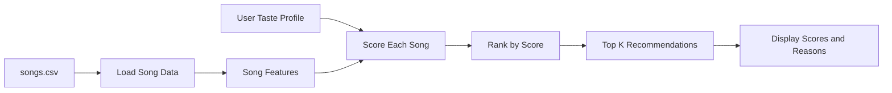

# 🎵 Music Recommender Simulation

## Project Summary

This project is a Python-based music recommendation system called **VibeMatch 1.0**. It recommends songs based on a user's preferred genre, mood, energy level, and optional acoustic preference.

The system uses a content-based filtering approach. It loads 20 songs from a CSV file, compares each song's features with the user's preferences, calculates a score, and ranks the songs from highest to lowest.

Each recommendation includes an explanation of how its score was calculated, making it easier to understand why certain songs were recommended.

The project also includes automated testing, an experiment comparing different scoring weights, and a Model Card explaining the system's limitations and potential biases.

---

## Content-Based vs. Collaborative Filtering

Music recommendation platforms use different methods to predict what users might enjoy.

**Collaborative filtering** uses information about other users' behavior. For example, if two people listen to similar music, the system might recommend songs that one person enjoys but the other hasn't discovered yet. This approach commonly uses listening history, likes, skips, and playlists.

**Content-based filtering** focuses on the features of the songs themselves. It compares attributes such as genre, mood, and energy with the user's preferences.

VibeMatch uses content-based filtering because it does not have real user listening histories or interaction data.

This approach is easier to understand and implement, but it can also limit recommendations to music that closely matches the preferences a user has already provided.

---

## How the System Works

### Dataset and Features

The music catalog is stored in `data/songs.csv`.

It contains 20 fictional songs: 10 from the starter repository and 10 additional songs added to increase the variety of genres, moods, and energy levels.

The dataset uses these columns:

```text
id,title,artist,genre,mood,energy,tempo_bpm,valence,danceability,acousticness
```

| Feature | Description | Used in Scoring? |
|---|---|---|
| `id` | Unique song identifier | Tie-breaking |
| `title` | Song title | Display and tie-breaking |
| `artist` | Artist name | Display |
| `genre` | Musical category | Yes |
| `mood` | Emotional feel of the song | Yes |
| `energy` | Energy level from 0 to 1 | Yes |
| `tempo_bpm` | Musical tempo | No |
| `valence` | Musical positivity | No |
| `danceability` | How suitable the song is for dancing | No |
| `acousticness` | Degree of acoustic sound | Optional |

The additional numerical features are loaded and validated even when they are not used in the current scoring formula.

### User Taste Profiles

A taste profile represents the type of music a user wants to hear.

For example:

```python
{
    "genre": "lofi",
    "mood": "chill",
    "target_energy": 0.35,
    "likes_acoustic": True
}
```

This profile describes someone who enjoys lofi music, prefers a relaxed mood, wants relatively low energy, and likes acoustic sounds.

The system also accepts `energy` as an alternative key for `target_energy`.

Taste profiles are represented using Python dictionaries. The starter `UserProfile` dataclass is also supported through the `Recommender` class.

### Scoring Algorithm

Each song receives points based on how closely it matches the user's preferences.

| Condition | Points |
|---|---|
| Matching genre | +2.0 |
| Matching mood | +1.0 |
| Energy similarity | Up to +1.0 |
| Acoustic similarity | Up to +0.5 |

**Genre matching**

If the song's genre matches the user's favorite genre, the system awards 2 points.

**Mood matching**

If the song's mood matches the preferred mood, the system awards 1 point.

**Energy similarity**

Energy is scored using:

```python
energy_score = max(
    0,
    1 - abs(song_energy - target_energy)
)
```

This formula rewards songs whose energy levels are close to the user's preference.

For example, if a user wants energy of 0.85 and a song has energy of 0.82:

```text
Energy score = 1 - |0.82 - 0.85|
Energy score = 0.97
```

**Acoustic similarity**

If the user provides an acoustic preference, the system calculates an additional score:

```python
# User likes acoustic music
acoustic_score = 0.5 * acousticness

# User does not prefer acoustic music
acoustic_score = 0.5 * (1 - acousticness)
```

The maximum total score is **4.5 points**, or **4.0 points** when no acoustic preference is provided.

### Ranking Songs

The `recommend_songs()` function calculates a score for every song in the catalog.

It then sorts the songs from highest to lowest score and returns the top `k` recommendations.

When songs have identical scores, the system uses their titles and IDs to produce a consistent order.

Every result includes:

- Song title and artist
- Genre and mood
- Final numerical score
- Reasons explaining the score

This makes the recommendations easier to evaluate rather than simply displaying a list of songs.

### System Data Flow



### Expected Limitations

Before running the evaluation, I expected genre to have a strong influence because it receives twice as many points as mood.

I also expected exact matching to create problems. For example, a song labeled `indie pop` would not receive genre points from a profile requesting `pop`.

Another concern was that the small dataset might produce better recommendations for genres with several songs than for genres represented by only one.

---

## Getting Started

### Requirements

- Python 3.10 or later
- pip
- Git
- pytest for automated testing

### Installation

Clone the repository:

```bash
git clone https://github.com/JuliusQuarshie/ai110-module3show-musicrecommendersimulation-starter.git
cd ai110-module3show-musicrecommendersimulation-starter
```

Create a virtual environment:

```bash
python3 -m venv .venv
```

Activate it on Linux or macOS:

```bash
source .venv/bin/activate
```

On Windows:

```powershell
.venv\Scripts\activate
```

Install the dependencies:

```bash
pip install -r requirements.txt
```

### Run the Music Recommender

To display recommendations for all evaluation profiles:

```bash
python3 -m src.main
```

To run the weight experiment:

```bash
python3 -m src.main --experiment
```

To change the number of recommendations displayed:

```bash
python3 -m src.main -k 3
```

The recommender itself uses Python's standard library.

---

## Sample Recommendation Output

I evaluated the system using four preference profiles:

1. High-Energy Pop
2. Chill Lofi
3. Intense Rock
4. Contradictory Preferences

The fourth profile intentionally combines preferences that do not naturally fit together, so I could see how the algorithm handles conflicting preferences.

The following output was generated by running:

```bash
python3 -m src.main
```

I simplified the spacing and separator lines for readability, but the songs, rankings, scores, and reasons are unchanged from the terminal output.

### Profile 1: High-Energy Pop

```text
Loaded songs: 20

Profile: High-Energy Pop
Prefs: {'genre': 'pop', 'mood': 'happy', 'target_energy': 0.85}

1. Sunrise City by Neon Echo [pop, happy] Score: 3.97
   - genre matches 'pop' (+2.00)
   - mood matches 'happy' (+1.00)
   - energy 0.82 vs target 0.85 (+0.97)

2. Gym Hero by Max Pulse [pop, intense] Score: 2.92
   - genre matches 'pop' (+2.00)
   - mood 'intense' is not 'happy' (+0.00)
   - energy 0.93 vs target 0.85 (+0.92)

3. Neon Heartbreak by Glass Arcade [pop, sad] Score: 2.79
   - genre matches 'pop' (+2.00)
   - mood 'sad' is not 'happy' (+0.00)
   - energy 0.64 vs target 0.85 (+0.79)

4. Rooftop Lights by Indigo Parade [indie pop, happy] Score: 1.91
   - genre 'indie pop' is not 'pop' (+0.00)
   - mood matches 'happy' (+1.00)
   - energy 0.76 vs target 0.85 (+0.91)

5. Basement Riot by Cutthroat Choir [rock, angry] Score: 0.97
   - genre 'rock' is not 'pop' (+0.00)
   - mood 'angry' is not 'happy' (+0.00)
   - energy 0.88 vs target 0.85 (+0.97)
```

The results show that genre has a strong influence. *Neon Heartbreak* ranked above *Rooftop Lights*, even though *Rooftop Lights* matched the requested happy mood and had an energy level closer to the user's target.

### Profile 2: Chill Lofi

```text
Profile: Chill Lofi
Prefs: {'genre': 'lofi', 'mood': 'chill', 'target_energy': 0.35, 'likes_acoustic': True}

1. Library Rain by Paper Lanterns [lofi, chill] Score: 4.43
   - genre matches 'lofi' (+2.00)
   - mood matches 'chill' (+1.00)
   - energy 0.35 vs target 0.35 (+1.00)
   - acoustic fit 0.86 (+0.43)

2. Midnight Coding by LoRoom [lofi, chill] Score: 4.29
   - genre matches 'lofi' (+2.00)
   - mood matches 'chill' (+1.00)
   - energy 0.42 vs target 0.35 (+0.93)
   - acoustic fit 0.71 (+0.35)

3. Focus Flow by LoRoom [lofi, focused] Score: 3.34
   - genre matches 'lofi' (+2.00)
   - mood 'focused' is not 'chill' (+0.00)
   - energy 0.40 vs target 0.35 (+0.95)
   - acoustic fit 0.78 (+0.39)

4. Spacewalk Thoughts by Orbit Bloom [ambient, chill] Score: 2.39
   - genre 'ambient' is not 'lofi' (+0.00)
   - mood matches 'chill' (+1.00)
   - energy 0.28 vs target 0.35 (+0.93)
   - acoustic fit 0.92 (+0.46)

5. Coffee Shop Stories by Slow Stereo [jazz, relaxed] Score: 1.43
   - genre 'jazz' is not 'lofi' (+0.00)
   - mood 'relaxed' is not 'chill' (+0.00)
   - energy 0.37 vs target 0.35 (+0.98)
   - acoustic fit 0.89 (+0.45)
```

This profile produced three lofi songs at the top. Their relatively low energy levels matched the user's preferences.

### Profile 3: Intense Rock

```text
Profile: Intense Rock
Prefs: {'genre': 'rock', 'mood': 'intense', 'target_energy': 0.9}

1. Storm Runner by Voltline [rock, intense] Score: 3.99
   - genre matches 'rock' (+2.00)
   - mood matches 'intense' (+1.00)
   - energy 0.91 vs target 0.90 (+0.99)

2. Basement Riot by Cutthroat Choir [rock, angry] Score: 2.98
   - genre matches 'rock' (+2.00)
   - mood 'angry' is not 'intense' (+0.00)
   - energy 0.88 vs target 0.90 (+0.98)

3. Gym Hero by Max Pulse [pop, intense] Score: 1.97
   - genre 'pop' is not 'rock' (+0.00)
   - mood matches 'intense' (+1.00)
   - energy 0.93 vs target 0.90 (+0.97)

4. Pulse Reactor by Kilowatt Kid [edm, euphoric] Score: 0.95
   - genre 'edm' is not 'rock' (+0.00)
   - mood 'euphoric' is not 'intense' (+0.00)
   - energy 0.95 vs target 0.90 (+0.95)

5. Iron Lung Parade by Grave Engine [metal, angry] Score: 0.93
   - genre 'metal' is not 'rock' (+0.00)
   - mood 'angry' is not 'intense' (+0.00)
   - energy 0.97 vs target 0.90 (+0.93)
```

The top two recommendations matched the rock genre, while the remaining songs were selected mainly because they had similar moods or high energy levels.

### Profile 4: Contradictory Preferences

```text
Profile: Contradictory (Ambient + Angry + 0.95)
Prefs: {'genre': 'ambient', 'mood': 'angry', 'target_energy': 0.95}

1. Spacewalk Thoughts by Orbit Bloom [ambient, chill] Score: 2.33
   - genre matches 'ambient' (+2.00)
   - mood 'chill' is not 'angry' (+0.00)
   - energy 0.28 vs target 0.95 (+0.33)

2. Iron Lung Parade by Grave Engine [metal, angry] Score: 1.98
   - genre 'metal' is not 'ambient' (+0.00)
   - mood matches 'angry' (+1.00)
   - energy 0.97 vs target 0.95 (+0.98)

3. Basement Riot by Cutthroat Choir [rock, angry] Score: 1.93
   - genre 'rock' is not 'ambient' (+0.00)
   - mood matches 'angry' (+1.00)
   - energy 0.88 vs target 0.95 (+0.93)

4. Pulse Reactor by Kilowatt Kid [edm, euphoric] Score: 1.00
   - genre 'edm' is not 'ambient' (+0.00)
   - mood 'euphoric' is not 'angry' (+0.00)
   - energy 0.95 vs target 0.95 (+1.00)

5. Gym Hero by Max Pulse [pop, intense] Score: 0.98
   - genre 'pop' is not 'ambient' (+0.00)
   - mood 'intense' is not 'angry' (+0.00)
   - energy 0.93 vs target 0.95 (+0.98)
```

This profile revealed a weakness in the scoring algorithm.

*Spacewalk Thoughts* ranked first because its genre matched, even though its mood and energy were far from the requested preferences.

That result motivated the weight experiment.

---

## Scoring Weight Experiment

### Experiment Setup

I wanted to see what would happen if energy similarity mattered more than matching the exact genre.

The original weights were:

| Feature | Original Weight | Experimental Weight |
|---|---:|---:|
| Genre | 2.0 | 1.0 |
| Mood | 1.0 | 1.0 |
| Energy | 1.0 | 2.0 |
| Acoustic | 0.5 | 0.5 |

The experiment was run using:

```bash
python3 -m src.main --experiment
```

The original scoring weights were preserved, so the experiment did not permanently change the default recommendations.

### Experiment Results

The following results were recorded from the CLI experiment. I simplified the table layout (the terminal labels the rank column `#`), but the rankings and scores are unchanged.

**High-Energy Pop**

```text
Rank  Baseline                     Experiment
1     Sunrise City (3.97)          Sunrise City (3.94)
2     Gym Hero (2.92)              Gym Hero (2.84)
3     Neon Heartbreak (2.79)       Rooftop Lights (2.82)
4     Rooftop Lights (1.91)        Neon Heartbreak (2.58)
5     Basement Riot (0.97)         Basement Riot (1.94)
```

**Chill Lofi**

```text
Rank  Baseline                     Experiment
1     Library Rain (4.43)          Library Rain (4.43)
2     Midnight Coding (4.29)       Midnight Coding (4.21)
3     Focus Flow (3.34)            Spacewalk Thoughts (3.32)
4     Spacewalk Thoughts (2.39)    Focus Flow (3.29)
5     Coffee Shop Stories (1.43)   Coffee Shop Stories (2.40)
```

**Intense Rock**

```text
Rank  Baseline                     Experiment
1     Storm Runner (3.99)          Storm Runner (3.98)
2     Basement Riot (2.98)         Basement Riot (2.96)
3     Gym Hero (1.97)              Gym Hero (2.94)
4     Pulse Reactor (0.95)         Pulse Reactor (1.90)
5     Iron Lung Parade (0.93)      Iron Lung Parade (1.86)
```

**Contradictory Preferences**

```text
Rank  Baseline                     Experiment
1     Spacewalk Thoughts (2.33)    Iron Lung Parade (2.96)
2     Iron Lung Parade (1.98)      Basement Riot (2.86)
3     Basement Riot (1.93)         Pulse Reactor (2.00)
4     Pulse Reactor (1.00)         Gym Hero (1.96)
5     Gym Hero (0.98)              Storm Runner (1.92)
```

### What Changed?

**High-Energy Pop:** *Rooftop Lights* moved from fourth to third, ahead of *Neon Heartbreak*. This made sense because *Rooftop Lights* matched the happy mood and had energy closer to the target, even though its genre was labeled indie pop instead of pop.

**Chill Lofi:** *Spacewalk Thoughts* moved above *Focus Flow*. Its matching mood and energy became more valuable than the exact genre match.

**Intense Rock:** The order stayed the same, but *Gym Hero* came much closer to *Basement Riot*. Their scores differed by only 0.02 points in the experiment.

**Contradictory Preferences:** This profile had the biggest change. *Spacewalk Thoughts* fell outside the top five, while *Iron Lung Parade* became the highest-ranked song because it matched the angry mood and had energy close to the target.

### What I Learned from the Experiment

The experiment showed that choosing weights is not just a mathematical decision. It affects what the system considers important.

Increasing the energy weight improved the contradictory profile, but it also reduced the advantage of matching the requested genre for the rock profile.

This suggests that different users might benefit from different scoring weights rather than forcing everyone to use the same scoring rules.

---

## Comparing User Profiles

### High-Energy Pop vs. Intense Rock

These profiles requested different genres but both preferred high-energy music.

They shared two songs in their top five: *Gym Hero* and *Basement Riot*.

*Gym Hero* received the genre bonus for the pop profile, while *Basement Riot* received it for the rock profile. This explains why their positions differed.

### Chill Lofi vs. Intense Rock

These profiles shared no songs in their top five.

The Chill Lofi recommendations had energy levels between 0.28 and 0.42, while the Intense Rock recommendations ranged from 0.88 to 0.97.

This shows that the recommender can produce noticeably different results when users have contrasting preferences.

### Intense Rock vs. Contradictory Preferences

Both profiles included high-energy preferences.

As a result, several energetic songs appeared in both recommendation lists.

However, the contradictory profile ranked a low-energy ambient song first because of the genre bonus. This highlighted how heavily the original algorithm depended on genre matching.

---

## Automated Testing

I used Claude Code to write and run a `pytest` suite for the recommender.

The tests cover:

- Loading songs from a CSV file.
- Converting numerical attributes into the correct Python types.
- Handling invalid or missing data.
- Calculating genre and mood scores.
- Calculating energy similarity.
- Applying the optional acoustic bonus.
- Returning explanations for recommendation scores.
- Sorting recommendations correctly.
- Returning the requested number of songs.
- Handling empty catalogs.
- Resolving tied scores consistently.
- Ensuring experimental weights do not modify the default scoring system.

### Run Tests

```bash
python3 -m pytest
```

### Test Results

```text
20 passed
```

All 20 automated tests passed during the final implementation run.

The test suite includes the starter tests and additional tests created to verify the new functionality.

---

## Limitations and Potential Biases

Although VibeMatch produces understandable recommendations, it has several limitations.

**1. Small dataset**

The catalog only contains 20 fictional songs. Some genres have only one song, making it difficult to recommend several relevant tracks for users with those preferences.

**2. Genre dominance**

Genre matching contributes more points than any other individual feature. This can cause songs with matching genres to rank higher even when their mood and energy are very different from what the user requested.

**3. Exact label matching**

The system treats similar genres and moods as completely different labels.

For example, `indie pop` does not match `pop`, and `relaxed` does not match `chill`.

**4. Limited recommendation diversity**

The algorithm can recommend several songs from the same genre or artist.

For example, two of the top three Chill Lofi recommendations were by LoRoom.

This could create a filter bubble where users repeatedly see similar music.

**5. Unused musical features**

Tempo, valence, and danceability are present in the dataset but are not included in the scoring algorithm.

**6. Limited user preferences**

A taste profile can represent only one favorite genre and mood at a time.

Real listeners often enjoy several styles depending on their activities or current moods.

For a more detailed discussion, see the [Model Card](model_card.md).

---

## Future Improvements

There are several ways I would improve VibeMatch if I continued developing it.

- Allow users to select multiple favorite genres and moods.
- Award partial points for related genres or moods.
- Include tempo, valence, and danceability in the scoring formula.
- Add a diversity rule to avoid repeated artists or genres.
- Expand the catalog with more songs from different cultures and musical styles.
- Introduce user feedback through likes, dislikes, and skips.
- Experiment with adjustable weights for different users.

A future version could also include a simple interface where users select their preferences and immediately see their recommendations.

---

## Personal Reflection

One of the biggest things I learned from this project was that a recommendation algorithm does not necessarily understand what music a person will enjoy. It follows the rules and weights that were built into it.

The contradictory profile made this clear to me. I expected an angry, high-energy song to rank highly, but the system recommended a calm ambient song first because the genre was worth two points. Looking at the explanations helped me understand why that happened.

I also found the weight experiment interesting. Changing only two values in the scoring system was enough to change several recommendations. It showed me that even a simple algorithm can behave quite differently depending on how its features are weighted.

I used Claude Code to help build the recommender, expand the dataset, generate tests, and document the evaluation results. The AI assistance made it possible to implement and test several parts of the project in one workflow. Reviewing the scoring explanations and experiment results was important because generating working code alone does not guarantee that the recommendations make sense.

Another thing I noticed was how much the dataset affects the results. Some genres were represented by multiple songs, while others had only one. This meant that the algorithm had more matching options for some users than for others, even though the same scoring rules were applied.

If I continued the project, I would focus on making the user profiles more flexible and giving users greater control over what matters most in their recommendations.

Overall, VibeMatch helped me better understand how data, user preferences, scoring rules, and ranking algorithms work together to generate recommendations. It also showed me why testing and evaluating an algorithm matters just as much as getting the code to run.

---

## AI-Assisted Development

Claude Code was used to assist with the implementation and testing of the project.

The AI-assisted workflow included reviewing the starter repository, implementing the scoring functions, expanding the dataset, creating automated tests, running the CLI experiments, and preparing documentation.

The implementation was checked using automated tests and actual recommendation outputs.

The file `ai_interactions.md` contains additional information about the AI collaboration process.

---

## Model Card

The project's Model Card explains the intended use, dataset, scoring rules, evaluation process, potential biases, limitations, and future improvements.

[View the Model Card](model_card.md)

---

## Technologies Used

- Python
- Python CSV Module
- Python Dataclasses
- Object-Oriented Programming
- Content-Based Recommendation Algorithms
- pytest
- Mermaid
- Git and GitHub
- Claude Code

---

## Repository

**GitHub:** https://github.com/JuliusQuarshie/ai110-module3show-musicrecommendersimulation-starter

The repository includes the recommendation algorithm, music dataset, CLI application, automated tests, README documentation, Model Card, and AI interaction log.