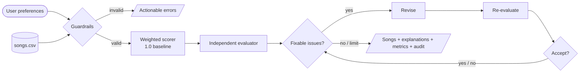

# VibeMatch 2.0

An explainable music recommender that checks its own output. VibeMatch 2.0 takes a listener's
preferred genre, mood, energy level and acoustic taste, ranks songs from a small catalog, and
then evaluates that list against independent quality checks. When it finds a fixable problem,
such as a song far from the requested energy or the same artist twice, it tries a bounded set of
revisions, re-evaluates them, and keeps a revision only if it is measurably better without
breaking the user's core preferences. Every result comes with per-song score explanations,
quality metrics, any catalog limitations, and an audit trail of what was tried and why.

The core is a deterministic, weighted content-based scorer, not a trained or language model.
The applied-AI part of the project is the reliability layer around it: input guardrails, an
evaluator that is independent of the scorer, and a self-correction loop with an explicit
acceptance policy.

**Repository:** https://github.com/JuliusQuarshie/vibematch-applied-ai-system

---

## Where this started: VibeMatch 1.0

VibeMatch 2.0 extends my CodePath AI110 Module 3 project, the **Music Recommender Simulation**
(https://github.com/JuliusQuarshie/ai110-module3show-musicrecommendersimulation-starter).

VibeMatch 1.0 loaded 20 fictional songs from a CSV file and scored each one against a taste
profile: +2.0 for a genre match, +1.0 for a mood match, up to +1.0 for energy closeness, and up
to +0.5 for acoustic fit. It returned the top five songs with a plain-language explanation of
every point, and included a weight-shift experiment, four evaluation profiles and 20 pytest
tests.

Its main weakness showed up in the contradictory profile (ambient + angry + energy 0.95): the
+2.0 genre bonus put a calm 0.28-energy ambient track first. 1.0 could explain that result but
had no way to notice it was a poor one.

### What changed in 2.0

| | VibeMatch 1.0 | VibeMatch 2.0 |
|---|---|---|
| Scoring | Weighted content-based scorer | Same scorer, unchanged (it produces the baseline) |
| Input handling | Assumed valid input | Validates every field, suggests corrections, flags impossible combinations |
| Catalog handling | Skipped bad CSV rows | Also rejects missing/empty/malformed files and removes duplicate songs |
| Quality checks | None | Independent evaluator: match rates vs. what the catalog allows, energy gaps, artist/genre diversity |
| Self-correction | None | Bounded evaluate → revise → re-evaluate → accept/reject loop (max 3 attempts) |
| Transparency | Score explanations | Explanations + quality metrics + catalog limitations + audit trail |
| Logging | None | Structured `key=value` logs to stderr and optional file |
| Evaluation | Manual comparison | Reproducible 1.0 vs 2.0 script with JSON and Markdown output |
| Tests | 20 | 120 (original 20 kept unchanged) |

The original Module 3 output is still available with `python -m src.main --v1` and
`python -m src.main --experiment`, and it matches the 1.0 output exactly.

### Why the reliability layer matters

A recommender can be "correct" according to its own formula and still give a bad answer. 1.0's
contradictory profile showed this: the math was right and the top song was wrong for the request.
Checking a list only by its own score is circular, because the score already agrees with itself.
2.0 judges lists with metrics computed directly from song attributes (did this song match the
requested mood? how far is its energy from the target? is this artist already in the list?) and
compares them with what the catalog could have delivered. That makes it possible to catch bad
results, try to fix them, and, just as important, refuse a "fix" that makes things worse.

---

## System architecture

Mermaid source: [`diagrams/architecture.mmd`](diagrams/architecture.mmd)



The simplified view above shows the main loop. The full diagram in the `.mmd` file also shows
logging, the CSV loader's guardrails, the evaluation script, automated tests and human review.

| Module | Responsibility |
|---|---|
| [`src/recommender.py`](src/recommender.py) | Original 1.0 engine: CSV loader, `score_song`, `recommend_songs`, `Recommender` class |
| [`src/guardrails.py`](src/guardrails.py) | Catalog loading checks, preference and `k` validation, feasibility warnings |
| [`src/evaluator.py`](src/evaluator.py) | Independent quality metrics and issue detection |
| [`src/agent.py`](src/agent.py) | The bounded plan / revise / re-evaluate / decide workflow |
| [`src/main.py`](src/main.py) | CLI for 2.0, plus the original 1.0 modes |
| [`src/evaluate.py`](src/evaluate.py) | Reproducible 1.0 vs 2.0 comparison |
| [`src/logging_config.py`](src/logging_config.py) | Structured logging setup |

---

## Setup

Tested on Python 3.11. The system itself uses only the standard library; `pytest` is the only
dependency.

```bash
git clone https://github.com/JuliusQuarshie/vibematch-applied-ai-system.git
cd vibematch-applied-ai-system
python3 -m venv .venv
source .venv/bin/activate        # Windows: .venv\Scripts\activate
pip install -r requirements.txt
```

## Running it

All commands are run from the repository root.

```bash
# VibeMatch 2.0 on all five built-in profiles
python -m src.main

# One built-in profile
python -m src.main --profile "Chill Lofi"

# Your own preferences (any subset of genre / mood / energy / acoustic)
python -m src.main --genre pop --mood happy --energy 0.8 --no-acoustic -k 5

# Machine-readable output, diagnostic logs, and the catalog vocabulary
python -m src.main --profile "Intense Rock" --json
python -m src.main --profile "Intense Rock" --log-level INFO --log-file vibematch.log
python -m src.main --list

# Original Module 3 behaviour
python -m src.main --v1
python -m src.main --experiment

# Tests
python -m pytest

# 1.0 vs 2.0 evaluation (writes evaluation/results.json and evaluation/summary.md)
python -m src.evaluate
```

Exit codes: `0` success, `1` catalog problem, `2` invalid input.

---

## Sample runs

These are copied from real runs. [`tests/test_readme_examples.py`](tests/test_readme_examples.py)
re-runs every command in this section and fails if the output here no longer matches.

### 1. Contradictory request: revision accepted, trade-off reported

```text
$ python -m src.main --profile "Contradictory (Ambient + Angry + 0.95)"
Loaded songs: 20

========================================================================
VibeMatch 2.0 | Profile: Contradictory (Ambient + Angry + 0.95)
Input:   genre=ambient, mood=angry, target_energy=0.95  (k=5)
Outcome: revision accepted  [final config: rebalanced weights]
------------------------------------------------------------------------
1. Iron Lung Parade by Grave Engine  [metal, angry, energy 0.97]  Score: 3.46
     - genre 'metal' is not 'ambient' (+0.00)
     - mood matches 'angry' (+1.50)
     - energy 0.97 vs target 0.95 (+1.96)
2. Basement Riot by Cutthroat Choir  [rock, angry, energy 0.88]  Score: 3.36
     - genre 'rock' is not 'ambient' (+0.00)
     - mood matches 'angry' (+1.50)
     - energy 0.88 vs target 0.95 (+1.86)
3. Pulse Reactor by Kilowatt Kid  [edm, euphoric, energy 0.95]  Score: 2.00
     - genre 'edm' is not 'ambient' (+0.00)
     - mood 'euphoric' is not 'angry' (+0.00)
     - energy 0.95 vs target 0.95 (+2.00)
4. Gym Hero by Max Pulse  [pop, intense, energy 0.93]  Score: 1.96
     - genre 'pop' is not 'ambient' (+0.00)
     - mood 'intense' is not 'angry' (+0.00)
     - energy 0.93 vs target 0.95 (+1.96)
5. Storm Runner by Voltline  [rock, intense, energy 0.91]  Score: 1.92
     - genre 'rock' is not 'ambient' (+0.00)
     - mood 'intense' is not 'angry' (+0.00)
     - energy 0.91 vs target 0.95 (+1.92)
Changed from baseline: removed ['Spacewalk Thoughts'], added ['Storm Runner']
Baseline quality: verdict=acceptable | genre 1/1 achievable | mood 2/2 achievable | mean energy gap 0.156 | artists 5/5 | genres 5
Quality: verdict=good | genre 0/1 achievable | mood 2/2 achievable | mean energy gap 0.030 | artists 5/5 | genres 4
Limit:   No song in the catalog is both 'ambient' and 'angry'. 'ambient' songs here are: chill.
Limit:   Every 'ambient' song is far from energy 0.95 (closest gap 0.67; available: 0.28).
Limit:   The catalog has only 1 'ambient' song(s); 4 slot(s) had to be filled from other genres.
Audit trail:
  - validated input: fields=['genre', 'mood', 'target_energy'], k=5, catalog=20 songs
  - baseline (default weights): verdict=acceptable, warnings=['ENERGY_MISMATCH']
  - attempt 1: rebalance_weights targeting ['ENERGY_MISMATCH'] -> ACCEPTED (Q1 passed: warnings 1 -> 0; trade-off: genre_matches 1 -> 0 (within the allowed loss of 1))
  - final (rebalanced weights): verdict=good, outcome=revision accepted
```

The baseline's top song was 0.67 away from the requested energy. The rebalanced list fixes that,
but it also drops the catalog's only ambient song. The output says so instead of hiding it.

### 2. Repeated artist: revision attempted and rejected

```text
$ python -m src.main --profile "Chill Lofi"
Loaded songs: 20

========================================================================
VibeMatch 2.0 | Profile: Chill Lofi
Input:   genre=lofi, mood=chill, target_energy=0.35, likes_acoustic=True  (k=5)
Outcome: revision rejected; baseline kept  [final config: default weights]
------------------------------------------------------------------------
1. Library Rain by Paper Lanterns  [lofi, chill, energy 0.35]  Score: 4.43
     - genre matches 'lofi' (+2.00)
     - mood matches 'chill' (+1.00)
     - energy 0.35 vs target 0.35 (+1.00)
     - acoustic fit 0.86 (+0.43)
2. Midnight Coding by LoRoom  [lofi, chill, energy 0.42]  Score: 4.29
     - genre matches 'lofi' (+2.00)
     - mood matches 'chill' (+1.00)
     - energy 0.42 vs target 0.35 (+0.93)
     - acoustic fit 0.71 (+0.35)
3. Focus Flow by LoRoom  [lofi, focused, energy 0.40]  Score: 3.34
     - genre matches 'lofi' (+2.00)
     - mood 'focused' is not 'chill' (+0.00)
     - energy 0.40 vs target 0.35 (+0.95)
     - acoustic fit 0.78 (+0.39)
4. Spacewalk Thoughts by Orbit Bloom  [ambient, chill, energy 0.28]  Score: 2.39
     - genre 'ambient' is not 'lofi' (+0.00)
     - mood matches 'chill' (+1.00)
     - energy 0.28 vs target 0.35 (+0.93)
     - acoustic fit 0.92 (+0.46)
5. Coffee Shop Stories by Slow Stereo  [jazz, relaxed, energy 0.37]  Score: 1.43
     - genre 'jazz' is not 'lofi' (+0.00)
     - mood 'relaxed' is not 'chill' (+0.00)
     - energy 0.37 vs target 0.35 (+0.98)
     - acoustic fit 0.89 (+0.45)
Quality: verdict=acceptable | genre 3/3 achievable | mood 3/3 achievable | mean energy gap 0.042 | artists 4/5 | genres 3
Issue:   LoRoom appears 2 times in the list.
Limit:   The catalog has only 3 'lofi' song(s); 2 slot(s) had to be filled from other genres.
Audit trail:
  - validated input: fields=['genre', 'likes_acoustic', 'mood', 'target_energy'], k=5, catalog=20 songs
  - baseline (default weights): verdict=acceptable, warnings=['REPEATED_ARTIST']
  - attempt 1: diversity_rerank targeting ['REPEATED_ARTIST'] -> REJECTED (Q1 failed: warnings did not decrease (1 -> 1))
  - final (default weights): verdict=acceptable, outcome=revision rejected; baseline kept
```

The evaluator flagged LoRoom appearing twice. Diversity re-ranking only moved *Focus Flow* from
3rd to 4th: even after its 1.0 penalty (3.34 → 2.34) it still beats the next non-LoRoom option,
*Coffee Shop Stories* (1.43), so the repeat was still there. The candidate did not reduce the issue count, so the system kept the original
list and reported the unresolved issue.

### 3. Clear request: no revision needed

```text
$ python -m src.main --genre rock --mood intense --energy 0.9 -k 3
Loaded songs: 20

========================================================================
VibeMatch 2.0 | Profile: Custom
Input:   genre=rock, mood=intense, target_energy=0.9  (k=3)
Outcome: no revision needed  [final config: default weights]
------------------------------------------------------------------------
1. Storm Runner by Voltline  [rock, intense, energy 0.91]  Score: 3.99
     - genre matches 'rock' (+2.00)
     - mood matches 'intense' (+1.00)
     - energy 0.91 vs target 0.90 (+0.99)
2. Basement Riot by Cutthroat Choir  [rock, angry, energy 0.88]  Score: 2.98
     - genre matches 'rock' (+2.00)
     - mood 'angry' is not 'intense' (+0.00)
     - energy 0.88 vs target 0.90 (+0.98)
3. Gym Hero by Max Pulse  [pop, intense, energy 0.93]  Score: 1.97
     - genre 'pop' is not 'rock' (+0.00)
     - mood matches 'intense' (+1.00)
     - energy 0.93 vs target 0.90 (+0.97)
Quality: verdict=good | genre 2/2 achievable | mood 2/2 achievable | mean energy gap 0.020 | artists 3/3 | genres 2
Limit:   The catalog has only 2 'rock' song(s); 1 slot(s) had to be filled from other genres.
Audit trail:
  - validated input: fields=['genre', 'mood', 'target_energy'], k=3, catalog=20 songs
  - baseline (default weights): verdict=good, warnings=[]
  - no fixable issues found; baseline kept
  - final (default weights): verdict=good, outcome=no revision needed
```

### 4. Invalid input: actionable errors instead of a crash

```text
$ python -m src.main --genre popp --mood happy --energy 1.5
Loaded songs: 20

========================================================================
VibeMatch 2.0 | Profile: Custom
Could not produce recommendations:
  - Unknown genre 'popp'. Did you mean 'pop'? Known genres: ambient, classical, country, edm, folk, hip hop, indie pop, jazz, lofi, metal, pop, r&b, reggae, rock, synthwave.
  - target_energy must be between 0 and 1 (got 1.5). Example: 0.8 for high energy.
```

This exits with status 2. All problems are reported at once so they can be fixed in one go.

---

## How it works

### Recommendation (unchanged from 1.0)

`score_song()` gives each song:

| Condition | Points |
|---|---|
| Genre equals the requested genre | +2.0 |
| Mood equals the requested mood | +1.0 |
| Energy closeness, `max(0, 1 - abs(song_energy - target))` | up to +1.0 |
| Acoustic fit (`acousticness`, or `1 - acousticness` for non-acoustic) | up to +0.5 |

`recommend_songs()` scores every song, sorts by score (ties broken by title, then id) and returns
the top `k`. Each explanation lists the points behind the score, and a test checks that those
points add up to the displayed score.

### Evaluation (independent of the scorer)

[`src/evaluator.py`](src/evaluator.py) never calls `score_song` (a test enforces this). It
computes:

- **Match quality:** genre and mood matches, each next to the *achievable* maximum (for example,
  the catalog has only 2 rock songs, so 2/2 is the best possible), mean and max energy distance,
  energy violations (songs more than 0.30 from the target), and off-target songs (no genre or
  mood match and outside the energy tolerance).
- **Diversity:** unique artists, the largest number of songs by one artist, unique genres.
- **Integrity:** duplicate songs.

Problems are labelled as **warnings**, which the workflow may try to fix (`ENERGY_MISMATCH`,
`OFF_TARGET`, `MOOD_MISSING`, `REPEATED_ARTIST`, `REPEATED_GENRE`, `DUPLICATE_SONG`), or as
**info**, which are catalog limitations it cannot fix and only reports
(`LIMITED_GENRE_COVERAGE`, `UNSATISFIABLE_COMBINATION`, `MOOD_NOT_IN_CATALOG`). Verdict: `good`
(0 warnings), `acceptable` (1–2), or `poor` (3 or more, or a duplicate/evaluation failure).

### Revision workflow

[`src/agent.py`](src/agent.py) runs:

1. Validate the catalog, `k`, and the preferences.
2. Generate the baseline with the original scorer and evaluate it.
3. Pick the first untried strategy that targets a current warning:
   - `rebalance_weights`, an alternative scoring configuration (genre 1.0, mood 1.5, energy 2.0),
     for energy/mood/off-target problems. These weights are close to the 1.0 weight-shift
     experiment, which had already fixed the contradictory profile.
   - `diversity_rerank`, a greedy re-rank that subtracts 1.0 for each earlier song by the same
     artist and 0.3 for each earlier song of the same non-requested genre.
4. Generate the candidate, evaluate it, and apply the acceptance policy.
5. Repeat until there are no fixable warnings, no untried strategies, or 3 attempts have run.

**Acceptance policy.** A candidate is kept only if all of these hold:

| Rule | Compared with | Requirement |
|---|---|---|
| H1 | baseline | No duplicate songs; same list length |
| H2 | baseline | Genre matches drop by at most 1 |
| H3 | baseline | Mood matches drop by at most 1 |
| Q1 | current list | Number of warnings strictly decreases |
| Q2 | current list | Energy violations do not increase |
| Q3 | current list | Mean energy gap rises by no more than 0.05 |

H-rules are measured against the baseline so small losses cannot pile up over several attempts.
Any accepted loss is written into the audit trail as a trade-off.

---

## Evaluation results: 1.0 vs 2.0

Full output: [`evaluation/summary.md`](evaluation/summary.md) and
[`evaluation/results.json`](evaluation/results.json), produced by `python -m src.evaluate` (k=5).

| Profile | Revision | Decision | Warnings (1.0 → 2.0) | Better in 2.0 | Worse in 2.0 |
|---|---|---|---|---|---|
| High-Energy Pop | not activated | not needed | 0 → 0 | none | none |
| Chill Lofi | activated | rejected | 1 → 1 | none | none |
| Intense Rock | not activated | not needed | 0 → 0 | none | none |
| Contradictory (Ambient + Angry + 0.95) | activated | accepted | 1 → 0 | mean energy gap (0.156 → 0.030), energy violations (1 → 0) | genre matches (1 → 0), unique genres (5 → 4) |
| Limited Coverage (Classical) | activated | rejected | 1 → 1 | none | none |

What this shows, and what it doesn't:

- 2.0 changed the final list for **one of five profiles**. Three revision attempts ran, and two
  were rejected because they did not remove the issue they targeted.
- The one accepted revision is a trade-off, not a pure win: better energy agreement and no
  far-off song, but the requested genre is now absent. A listener who really wanted ambient music
  may prefer the 1.0 list. The policy allowed this because the catalog cannot satisfy ambient,
  angry and high energy together.
- In the Classical profile, *Neon Heartbreak* (energy 0.64 vs. target 0.20) stays in the list
  because it is one of only two "sad" songs. The rebalanced weights raised the mood bonus, so it
  stayed. The issue is reported, not fixed.
- These are rule-based measurements of agreement with stated preferences. They are **not**
  measurements of listener satisfaction or real-world accuracy. No users were involved.

---

## Design decisions and trade-offs

- **Keep the 1.0 scorer as-is.** The baseline is exactly the Module 3 output (tested), so every
  2.0 change can be compared with a known reference.
- **Evaluate with different measures than the scorer uses.** Accepting a revision because its
  weighted score went up would be circular. The evaluator works from song attributes and catalog
  counts only.
- **Relevance outranks diversity.** Diversity re-ranking applies a moderate penalty (1.0), so it
  never swaps in a much worse song just to avoid a repeat. That is why Chill Lofi keeps two LoRoom
  songs. A larger penalty would remove the repeat but cost a lofi song, which H2 would allow. The
  penalty was set before the evaluation ran and was deliberately not raised afterwards, so the
  policy was not tuned to make the results look better.
- **Allow at most one slot of relevance loss.** Zero tolerance would block every fix for
  contradictory requests. Unlimited tolerance would let diversity replace the user's genre
  entirely. One slot out of five is a middle ground, and it is a judgement call.
- **Report limitations, don't invent matches.** When the catalog cannot satisfy a request (one
  classical song, no "ambient + angry" song), the output says so explicitly.
- **Bounded by construction.** At most 3 attempts, and each strategy is tried once. A test forces
  a planner that always asks for another attempt and checks the loop still stops.
- **Deterministic.** No randomness, stable tie-breaking, and no timestamps in evaluation output.
  Re-running produces identical results (tested).

## Guardrails and logging

| Situation | Behaviour |
|---|---|
| Empty input / no usable fields | Error asking for at least one of genre, mood, energy |
| Unknown genre or mood | Error with a "did you mean" suggestion and the known values |
| Energy outside 0–1, non-numeric, NaN, boolean | Error with an example of a valid value |
| `target_energy` and `energy` both given and different | Error: conflicting values |
| Invalid `k` (0, negative, > 10, non-integer) | Error; `k` larger than the catalog is reduced, with a note |
| Missing file, empty file, missing columns | Catalog error, exit code 1 |
| Malformed rows | Skipped and reported; catalog error if none remain |
| Duplicate songs (same id, or same title + artist) | Later copies removed, with a warning |
| Contradictory or unsatisfiable preferences | Recommendations still produced, with "Limit:" lines explaining what can't be met |
| Evaluator or revision step throws | Logged with traceback; baseline returned with a note |

Logs use `event=name key=value` records (for example
`event=revision_accepted attempt=1 strategy=rebalance_weights warnings_after=0 warnings_before=1`).
At INFO level the pipeline logs which preference *fields* were supplied, not their values. A test
checks that genre and mood values do not appear in INFO logs. Raw values appear only at DEBUG.

## Testing

```bash
python -m pytest
```

Latest run: **120 passed** (Python 3.11.2, pytest 9.2.0).

| File | Tests | Covers |
|---|---|---|
| `tests/test_recommender.py` | 2 | Original starter tests (unchanged) |
| `tests/test_scoring.py` | 18 | Original Module 3 scoring, loading, ranking, tie-breaking (unchanged) |
| `tests/test_guardrails.py` | 37 | Valid/invalid preferences, `k`, conflicts, malformed/empty/duplicate catalogs |
| `tests/test_evaluator.py` | 13 | Hand-checked metrics, repeated artists/genres, low-quality detection, evaluator isolation, safe failure |
| `tests/test_agent.py` | 32 | Baseline preservation, every acceptance rule, accepted and rejected revisions, bounded loop, determinism, explanation consistency, failure handling, log privacy |
| `tests/test_cli.py` | 13 | CLI modes, exit codes, JSON output, 1.0 compatibility, log files |
| `tests/test_evaluate_script.py` | 4 | Required profiles, reproducibility, committed results match current code |
| `tests/test_readme_examples.py` | 1 | The sample runs in this README match the real output |

## Limitations and future work

- **Tiny, fictional catalog.** 20 songs; most genres have one song, and the largest have three.
  Many results are shaped more by what exists than by the algorithm.
- **Hand-set thresholds.** The 0.30 energy tolerance, the penalties and the one-slot loss rule
  are reasoned defaults, not values fitted to real listener data.
- **Exact label matching.** "indie pop" gets no credit for "pop", and "melancholy" none for
  "sad".
- **No user feedback.** There are no listening histories, skips or likes, so there is no way to
  measure satisfaction. Real user testing would be the next step before claiming the revisions
  help.
- **Limited strategies.** Two revision strategies. Future options: related-genre partial credit,
  using valence/tempo/danceability, multi-genre profiles, and letting users choose how much
  diversity they want.

## Technical reflection

The most valuable addition in 2.0 is not a better ranking but a way to tell when a ranking is
bad. 1.0 could explain any result, including a wrong one. An evaluator that doesn't share the
scorer's assumptions makes those cases visible. Writing the acceptance policy forced trade-offs
that 1.0 made implicitly into explicit rules, such as how much genre relevance may be given up
for diversity or energy agreement. The rejected revisions were as informative as the accepted
one: with a 20-song catalog the limiting factor is usually the data, and a "self-correcting"
system needs explicit rules for when not to change anything.

For me, the biggest lesson was that getting a system to produce an output is different from
making sure that output is useful and reliable. The contradictory profile showed this well: 2.0
fixed the energy mismatch but lost the requested genre, which made me realize that reliability
can't always be reduced to a single score, and that the rules used to judge quality are design
decisions too. Working with Claude Code also showed me that AI can speed up implementation, but
it still needs clear requirements, constraints, and verification.

## Documentation

- [Model Card](model_card.md): intended use, data, evaluation, bias, responsible AI reflection
- [AI collaboration log](ai_interactions.md)
- [Evaluation summary](evaluation/summary.md)
- [Architecture diagram source](diagrams/architecture.mmd)

## Technologies

Python 3 standard library (csv, dataclasses, logging, argparse, json, difflib), pytest, Mermaid,
Git/GitHub. Developed with Claude Code as an AI pair programmer (see
[ai_interactions.md](ai_interactions.md)).
